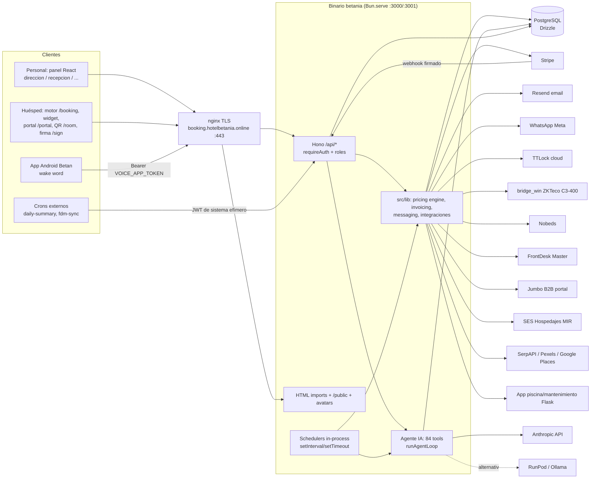

# Betan Booking Manager (betan-bm) — Arquitectura técnica

> Verificado sobre el código de `betania-booking-manager` (rama `dubai`). Complementa a `01-FUNCIONALIDADES.md`.

---

## 1. Stack

| Capa | Tecnología |
|---|---|
| Runtime | **Bun** (también para tests `bun test`, build y scripts) |
| Lenguaje | TypeScript (ESM) |
| Backend HTTP | **Hono 4** montado dentro de `Bun.serve()` (rutas `/api/*` → `app.fetch`), validación con `zod` + `@hono/zod-validator` |
| Frontend (panel) | **React 19** + `react-router-dom 7`, `recharts`, `d3-geo`/`topojson-client` (mapas), CSS propio (temas por usuario) |
| Frontend público | React 19 con páginas independientes (`booking`, `booking-widget`, `portal`, `portal-widget`, `room`, `contract`), i18n de 7 idiomas (es, en, fr, de, it, uk, zh) |
| Bundling | HTML imports de Bun (`import index from './frontend/index.html'`), sin Vite |
| Base de datos | **PostgreSQL** (cliente `postgres` + **Drizzle ORM 0.45**, `drizzle-kit` para migraciones); 71 tablas Drizzle + 3 solo SQL; 133 migraciones (`drizzle/0000…0132`) |
| Auth | JWT HS256 (`hono/jwt`), `Bun.password` (hash), cookie httpOnly |
| Pagos | `stripe` (Checkout + webhook) |
| Email | `resend` |
| IA | `@anthropic-ai/sdk` (Haiku 4.5), alternativas RunPod/Ollama |
| Otros | `pdf-lib`, `qrcode`, `@resvg/resvg-js` (PNG de gráficos para email), `xlsx`, `fflate` (ZIP para SES), `csv-parse` |
| Proceso | Un único proceso/binario sirve API, SPA del panel, páginas públicas, PDFs y avatares, y ejecuta los schedulers |

## 2. Estructura de carpetas

```
betania-booking-manager/
├─ index.ts                 Arranque: Hono + Bun.serve, montaje de rutas, rutas estáticas, schedulers
├─ package.json             scripts: dev, build (--compile), deploy:test|prod, db:migrate:*
├─ drizzle.config.ts        drizzle-kit (schema ./src/db/schema/index.ts → ./drizzle)
├─ drizzle/                 133 migraciones SQL + meta/
├─ src/
│  ├─ db/                   index.ts (cliente), seed.ts, schema/ (18 ficheros por dominio)
│  ├─ middleware/auth.ts    requireAuth, isAdmin, canUseFdm, canManageReservations, requireAdmin
│  ├─ routes/               34 routers Hono (ai, reservations, public, catalog, financial, alerts...)
│  └─ lib/                  lógica de dominio e integraciones (pricingRulesEngine, price-resolver,
│                           ses, ttlock, zkteco, nobeds, fdm-push, jumbo-push, stripe, email,
│                           messaging, whatsapp, poolControl, serpapi, pexels, invoicing, ...) + 4 tests
├─ frontend/                Panel de personal: App.tsx (rutas), views/ (35 vistas), components/,
│                           contexts/AuthContext, hooks/, lib/ (api, speech, idDocValidation), data/
├─ frontend-public/         Motor de reservas, widgets, portal, QR de habitación, contrato (+ i18n)
├─ public/                  avatars/, docs/contrato-admision.pdf (embebido en el binario)
├─ scripts/                 migrate.ts, seeds, importaciones FDM, debug, crons (daily-summary, fdm-sync),
│                           backup-db.sh + betania-db-backup.{service,timer}, print-room-qrs, tests de integración
├─ deploy/                  betania-{prod,test}.service, nginx.conf, setup-db.sql, README.md
├─ docs/agent-questions.md  Banco de preguntas para el agente IA
├─ APRENDIZAJE.txt          Notas de aprendizaje/decisiones
└─ dist/                    Salida de bun build --compile (dist/betania)
```

## 3. Diagrama de componentes



## 4. Rutas montadas en `index.ts`

- **Sin `requireAuth` global (auth propia)**: `/api/auth`, `/api/public` (motor web, Stripe webhook, magic link, contrato), `/api/zkteco` (X-Enroller-Key para el enroller + JWT inline para el resto), `/api/room-access` (JWT `type=room-guest`), `/api/voice-brief` (token estático), `/api/health`.
- **Con `requireAuth`** (cookie `auth_token` o `Authorization: Bearer`): users, dashboard, reservations, guests, id-scan, postal, rooms, financial, catalog, notifications, ai, settings, reports, ttlock, ses, housekeeping, laundry, nobeds, fdm, jumbo, customer (usa su propio JWT de cliente dentro), alerts, engagement, feedback, pricing-effects, corporate, cash-drawer, whatsapp, competitors.
- `Bun.serve.routes`: `/api/*` (con try/catch global → 500 JSON), `/avatars/:file`, PDF de contrato embebido, `/public/*`, páginas `/booking`, `/booking/success`, `/booking-widget(/success)`, `/portal`, `/portal-widget`, `/sign`, `/room` y `/*` → SPA del panel.
- `idleTimeout: 120` s (el informe diario y el chequeo proactivo mantienen la conexión 25-35 s+).

## 5. Schedulers y cron

Todos los `start*` se llaman al final de `index.ts` y corren **dentro del proceso** (sin cola ni lock distribuido).

| Scheduler | Fichero | Frecuencia | Qué hace |
|---|---|---|---|
| Auto-estado de reservas | `src/lib/autoStatus.ts` | Diario 12:00:05 (hora del servidor) | confirmed→arriving, →no_show, checked_in→checking_out; cancela tentatives caducadas y carritos web sin pagar tras `maxAgeHours` |
| Recuperación de carritos | `src/lib/cartRecovery.ts` | Al arrancar + cada 10 min | Detecta carritos, envía email/WhatsApp con descuento |
| Reenganche de canceladas | `src/lib/cancellationRecovery.ts` | Al arrancar + cada 10 min | Descuento a canceladas recientes |
| Tareas programadas + briefing del agente | `src/routes/ai.ts` (`startAiScheduledTasksScheduler`) | Al arrancar + cada 5 min | Ejecuta `ai_scheduled_tasks` vencidas; briefing matutino (08–13 h Madrid, 1/día) |
| Eventos locales | `src/lib/eventsScheduler.ts` | Diario 09:00 Madrid | SerpAPI → mensaje interno a dirección si hay eventos de impacto alto/medio a 30 d |
| Motor de reglas de precio | `src/lib/pricingRulesEngine.ts` | Cada 30 min | Ajusta Dir AL y empuja a Jumbo |
| Precios de competidores | `src/lib/competitorPricing.ts` | Diario 06:00 | Refresca `competitor_prices` |

Fuera del proceso (cron/systemd externos, no instalados por `deploy/`):
- `bun scripts/daily-summary-cron.ts` — informe diario por email (diseñado para 23:00 Madrid) → `POST /api/ai/daily-summary` con JWT de sistema.
- `bun scripts/fdm-sync-cron.ts` — sync incremental FDM → BD (ayer … +60 d) → `POST /api/fdm/sync-reservations`.
- `scripts/betania-db-backup.timer` — backup `pg_dump` a las 03:00 (ver §10).

## 6. Modelo de datos (por dominio)

71 tablas en `src/db/schema/*` + 3 solo en migraciones SQL (marcadas *).

| Dominio (fichero) | Tablas |
|---|---|
| Núcleo (`core.ts`) | `properties`, `currencies`, `countries`, `users`, `password_reset_tokens`, `user_preferences`, `user_roles`, `alert_configs`, `alert_seen_marks` |
| Habitaciones (`rooms.ts`) | `room_types`, `rooms`, `room_avail_overrides` |
| Reservas (`reservations.ts`) | `operators`, `booking_channels`, `rates`, `rate_daily_prices`, `reservations`, `reservation_nights`, `reservation_notes`, `reservation_field_rules`, `room_access_visits`; * `reservation_status_logs` |
| Huéspedes y contratos (`guests.ts`, `contracts.ts`) | `guests`, `guest_contracts` |
| Precios (`pricing.ts`) | `seasons`, `pricing_rules`, `pricing_rule_applications`, `price_change_log`, `demand_pulse_state`, `fdm_push_state`, `jumbo_push_state` |
| Motor web (`booking-engine.ts`) | `customer_tokens`, `abandoned_carts`, `cart_recovery_settings`, `cancellation_recoveries`, `cancellation_recovery_settings`, `temporary_discount_settings`, `booking_discount_timers` |
| Competencia (`competitors.ts`) | `competitor_hotels`, `competitor_prices` |
| Finanzas (`financial.ts`) | `payment_method_configs`, `financial_accounts`, `shifts`, `financial_transactions`, `payment_date_corrections`, `cash_collections`, `sale_items`, `reservation_sale_items`, `deposit_items`, `invoices`, `invoice_settings`, `message_settings`, `message_templates`, `change_drawer_counts`, `change_drawer_expenses`, `change_drawer_deposit_checks`, `notifications`, `blocked_beds` |
| Housekeeping (`housekeeping.ts`, `laundry.ts`) | `housekeeping_tasks`, `common_area_tasks`, `breakfast_no_service`, `breakfast_service_ratings`, `laundry_deliveries`, `laundry_process_batches`, `laundry_process_items`; * `breakfast_logs` |
| Alertas (`alerts.ts`) | `alert_events` |
| Feedback (`feedback.ts`) | `feedback_threads`, `feedback_comments` |
| Corporativo (`corporate.ts`) | `corporate_offers` |
| IA (`ai.ts`) | `ai_chat_messages`, `staff_messages`, `ai_scheduled_tasks` |
| Otros (SQL) | * `engagement_adjustments` |

Enums: `reservation_status`, `gender`, `id_doc_type`, `payment_method`, `adjust_type`, `bathroom_type`, `terrace_type`, `bed_size`, `staff_role`, `view_type`.
Convenciones: `property_id` en casi todas las tablas (pero fijado a 1 en el código), importes `numeric(10,2)` en EUR, timestamps `with time zone`, fechas de estancia `date`, zona horaria de negocio `Europe/Madrid` (hay helpers explícitos porque el servidor puede ir en UTC).

## 7. Autenticación y roles

- **Personal**: `POST /api/auth/login` verifica con `Bun.password.verify`; emite JWT HS256 firmado con `JWT_SECRET` (payload: `sub`, `roles[]`, `isPrimary`, `exp` 7 días) y lo guarda en cookie `auth_token` (httpOnly, SameSite=Lax). `requireAuth` acepta cookie o `Authorization: Bearer`. 401 "Sesión caducada" y el frontend dispara `auth:expired`.
- **Roles** (`staff_role`): `direccion`, `recepcion`, `conserje`, `mantenimiento`, `limpieza`, `cocina`; `users.isPrimary` = superadmin. Un usuario puede tener varios roles (`user_roles`).
- **Helpers backend**: `isAdmin` (isPrimary o rol dirección), `canUseFdm`/`canManageReservations` (dirección + recepción), `requireAdmin`. Muchas rutas aplican el control dentro del handler (p. ej. editar importes solo admin, descripciones también recepción).
- **Frontend**: `AuthContext` (+ `viewAsRole` para que un admin simule otro rol, solo en sesión), guardas `Access` por ruta (`onlyDireccion`, `notLimpieza`, `recepcionODireccion`) y filtrado del `Sidebar`. `limpieza` aterriza en Housekeeping.
- **Huésped (portal)**: JWT `type=customer` (30 días) obtenido por magic link por email; tabla `customer_tokens`.
- **Huésped (QR)**: JWT `type=room-guest` corto, ligado a una reserva y habitación; token del QR opaco (`rooms.qrToken`).
- **Dispositivos**: ZKTeco enroller con cabecera `X-Enroller-Key` (`ZKTECO_ENROLLER_SECRET`); app Android con `Authorization: Bearer VOICE_APP_TOKEN`; bridge Windows con `X-API-Key`.
- **Crons internos**: JWT de sistema efímero firmado con el mismo `JWT_SECRET` (los scripts lo generan y llaman a la API local).
- **Agente IA**: hereda `roles` del usuario (`ctxForUser`); tools "solo dirección" se rechazan en ejecución para otros roles; las escrituras exigen `confirmed=true`.

## 8. Variables de entorno

Validadas con zod en `src/lib/env.ts` solo las primeras; el resto se leen directamente de `process.env` en cada integración. `.env` lo carga Bun automáticamente; en servidor lo carga systemd (`EnvironmentFile`) y **no se sincroniza** con el despliegue. (Solo se listan nombres.)

| Variable | Para qué | Oblig. |
|---|---|---|
| `DATABASE_URL` | URL PostgreSQL (app, migraciones, drizzle-kit) | **Obligatoria** (el proceso aborta si falta o no es URL) |
| `JWT_SECRET` | Firma de JWT de personal, cliente, QR y crons (≥32 caracteres) | **Obligatoria** |
| `PORT` | Puerto HTTP (def. 3000; prod 3000, test 3001) | Opcional |
| `PUBLIC_URL` | URL pública base para enlaces de email/portal/Stripe (def. `http://localhost:3000`) | Obligatoria en producción (si no, enlaces rotos) |
| `STRIPE_SECRET_KEY` | API de Stripe (checkout, ampliaciones, pagos) | Opcional (sin ella no hay pago online) |
| `STRIPE_WEBHOOK_SECRET` | Verificación de firma del webhook | Obligatoria si hay Stripe |
| `STRIPE_PUBLIC_KEY` | Clave pública (validada en env) | Opcional |
| `RESEND_API_KEY` | Envío de email transaccional | Prácticamente obligatoria (`email.ts` instancia Resend al importar) |
| `EMAIL_FROM` | Remitente (def. `Hotel Betania <recepcion@hotelbetania.es>`) | Opcional |
| `HOTEL_EMAIL` | Destino de solicitudes de factura (def. `recepcion@hotelbetania.es`) | Opcional |
| `ANTHROPIC_API_KEY` | Agente IA (backend `claude`) y escaneo de DNI | Obligatoria para IA/DNI scan |
| `AI_BACKEND` | `claude` (def.) / `runpod` / `ollama` | Opcional |
| `RUNPOD_ENDPOINT_ID`, `AI_AGENT_API_KEY`, `RUNPOD_MODEL` | Backend RunPod serverless / modelo Ollama (def. `llama3.1:8b`) | Opcional (solo si `AI_BACKEND` ≠ claude) |
| `VOICE_APP_TOKEN` | Token estático de la app Android (sin él, `/api/voice-brief` responde 503) | Opcional |
| `VOICE_APP_USER_ID` | Usuario en nombre del cual actúa el agente para la app Android | Opcional |
| `WHATSAPP_TOKEN`, `WHATSAPP_PHONE_ID` | WhatsApp Cloud API (token permanente, Phone Number ID) | Opcional |
| `TTLOCK_CLIENT_ID`, `TTLOCK_CLIENT_SECRET`, `TTLOCK_USERNAME`, `TTLOCK_PASSWORD` | Credenciales de la nube TTLock | Opcional (códigos de cerradura) |
| `ZKTECO_BRIDGE_URL`, `ZKTECO_BRIDGE_KEY` | Endpoint y API key del bridge Windows del controlador C3-400 | Opcional |
| `ZKTECO_ENROLLER_SECRET` | Secreto de `enroller.exe` (X-Enroller-Key) | Opcional |
| `SES_USERNAME`, `SES_PASSWORD`, `SES_CODIGO_ARRENDADOR`, `SES_CODIGO_ESTABLECIMIENTO` | Credenciales y códigos SES Hospedajes | Opcional (obligatorias para comunicar viajeros) |
| `SES_APLICACION`, `SES_PRODUCCION` | Nombre de aplicación (def. "Betania PMS") y `true` para entorno real (def. pruebas) | Opcional |
| `NOBEDS_API_TOKEN` | Channel manager Nobeds | Opcional |
| `FDM_USERNAME`, `FDM_PASSWORD` o `FDM_CM_TOKEN` | Acceso a FrontDesk Master (el token tiene prioridad) | Opcional |
| `JUMBO_LOGIN`, `JUMBO_PASSWORD` | Acceso al portal B2B de Jumbo | Opcional |
| `JUMBO_BUILDING_ID`, `JUMBO_HANDLER_ID`, `JUMBO_PC_ID`, `JUMBO_RATE_IDS`, `JUMBO_ROOM_IDS`, `JUMBO_BOARD_IDS` | Identificadores del contrato Jumbo (con defaults del hotel en código) | Opcional |
| `GOOGLE_PLACES_API_KEY` | Autocompletado de direcciones (proxy servidor) | Opcional |
| `GOOGLE_ADS_ID`, `GOOGLE_ADS_CONVERSION_LABEL` | Conversión Google Ads en el motor web | Opcional |
| `SERPAPI_API_KEY` | Eventos locales | Opcional |
| `PEXELS_API_KEY` | Fotos de fondo del panel | Opcional |
| `POOL_API_URL`, `POOL_API_KEY` | API de solo lectura de la app de piscina/mantenimiento | Opcional |

Notas: `TTLOCK_*` se leen con `!` al cargar el módulo (falta de variables = fallo en uso, no en arranque; hay `isConfigured()` que desactiva el flujo con 503). `APP_URL` (def. `http://localhost:3000`) la usan solo los scripts de cron.

## 9. Despliegue

- **Build**: `bun run build` → `bun build --compile --target=bun-linux-x64 ./index.ts --outfile ./dist/betania` (~50 MB: runtime Bun + backend + frontends React bundleados + PDF de contrato embebido con `with { type: 'file' }`).
- **Entornos** en un único servidor Linux (el código menciona hora UTC del servidor): `/srv/hotelbetania.online/bbm/prod` (puerto 3000, `booking.hotelbetania.online`, BD `betania_prod`) y `/test` (puerto 3001, `booking-test.hotelbetania.online`, BD `betania_test`).
- **Publicación**: `deploy:test|prod` = build + `rsync` de `dist/betania`, `drizzle/` y `scripts/migrate.ts` a `direccion@hotelbetania.es` + `sudo systemctl restart betania-{test|prod}`.
- **Migraciones**: `db:migrate:test|prod` ejecuta por SSH `bun run scripts/migrate.ts` (drizzle migrator, `./drizzle`, esquema `public`). **Política: nunca automáticas**; las lanza el propietario a mano. Requiere Bun instalado en el servidor solo para esto.
- **systemd** (`deploy/betania-{prod,test}.service`): `User=www-data`, `WorkingDirectory` del entorno, `EnvironmentFile=.env`, `ExecStart=…/betania`, `Restart=on-failure` (5 s), logs al journal (`SyslogIdentifier=betania-*`), `After=postgresql.service`.
- **nginx** (`deploy/nginx.conf`): TLS Let's Encrypt (certbot), `proxy_pass` a 127.0.0.1:3000/3001, cabeceras `Upgrade/Connection`, `X-Real-IP`, `X-Forwarded-For`; para `/booking*` añade `Content-Security-Policy: frame-ancestors 'self' https://hotelbetania.es https://www.hotelbetania.es` (permite incrustar el widget en la web del hotel); redirección 80→443.
- **PostgreSQL**: `deploy/setup-db.sql` crea usuario `betania` y BDs prod/test (UTF8, collation es_ES).
- **Backups**: `scripts/backup-db.sh` hace `pg_dump -Fc` a `/var/backups/betania-db/` y borra los antiguos; `betania-db-backup.timer` lo lanza a diario a las 03:00 (`Persistent=true`) con un servicio `oneshot` como usuario `postgres`. Hoy el script apunta a `betania_test` y retiene 3 días (el comentario dice 14): conviene revisarlo para producción. Sin copia automática de `public/avatars` ni de `.env`.
- **Observabilidad**: logs a stdout/journal; `log-bus` en memoria (historial + suscripción) alimenta AI Debug y `GET /api/ai/logs`; `GET /api/health`.

## 10. Integraciones externas y modo de acoplamiento

| Integración | Dirección | Modo de acoplamiento | Fallo/desactivación |
|---|---|---|---|
| Stripe | Out (API) + In (webhook firmado) | SDK oficial; webhook `POST /api/public/stripe/webhook` con `constructEventAsync`, idempotente por `onlinePaymentId` | Sin claves: pagos online desactivados (`requireStripe`) |
| Resend | Out | SDK; plantillas HTML propias editables | Si falla, flujos continúan sin bloquear |
| WhatsApp Meta | Out | REST Cloud API, plantillas pre-aprobadas | `isWhatsappConfigured()`; canal desactivable por tipo de mensaje |
| Anthropic | Out | SDK, tool use, prompt caching; visión para DNI | Sin clave: agente no disponible (`AI_UNAVAILABLE_TEXT`) |
| RunPod / Ollama | Out | HTTP, formato Ollama/OpenAI normalizado | Alternativos, opt-in por `AI_BACKEND` |
| TTLock | Out | API cloud REST con token OAuth en memoria (renovación) | `isConfigured()` → 503 |
| ZKTeco C3-400 | Out + In | **Bridge propio** (`bridge_win`, PC Windows en la red del hotel) con REST + API key; `enroller.exe` llama a la app con `X-Enroller-Key` | Sin `ZKTECO_BRIDGE_URL`: funciones deshabilitadas |
| Nobeds | Out | API REST con token; sync **a demanda** desde el panel | Solo dirección, manual |
| FDM / FrontDesk Master | Out | API REST premium (WCF dates) con login o token CM; sync por cron externo + botón; push de precios | Manual/cron; `isConfigured()` |
| Jumbo | Out | **Login por formulario y llamadas al JS del portal** (sin API oficial); push en segundo plano, estado en `jumbo_push_state`; disparado también por el motor de reglas | Frágil ante cambios del proveedor |
| SES Hospedajes | Out | SOAP/HTTPS + Basic Auth, XML ZIP+Base64 (XSD v3.1.3); pre/pro conmutable | Envío manual |
| Google Places | Out | Proxy servidor (la key no sale al cliente) | Opcional |
| Google Ads (gtag) | Out (navegador) | ID/label expuestos en `GET /api/public/config` | Opcional |
| SerpAPI | Out | REST; caché diaria en memoria | Opcional; programador de eventos |
| Pexels | Out | REST | Opcional |
| App piscina/mantenimiento | Out (solo lectura) | REST GET con `X-API-Key`; alimenta tools de IA, alertas y engagement | Opcional |
| App Android | In | Bearer estático a `/api/voice-brief` | Sin token: 503 |
| Competidores | Out | Lectura de la API pública del motor de reservas del competidor (parsers Paraty/Cloudbeds) | Un fallo no afecta al resto |

## 11. Decisiones y consideraciones de diseño

- **Monolito de un solo binario** con BD única: despliegue simple (rsync + systemctl), sin Docker ni orquestador.
- **Lógica de precio centralizada** (`price-resolver.ts`) compartida por motor web, panel y agente; **ocupación de calendario** (`calendarOccupancy.ts`) como única definición para reglas, calendario y alertas.
- **Fuente de verdad del precio**: `rate_daily_prices.basePrice` (manual) vs `price` (ajustado por reglas); las reglas nunca acumulan sobre su propio resultado.
- **Dinero real**: `paymentAggregate.ts` define saldo pendiente sin contar depósitos retenidos; lo reutilizan portal, facturas, alertas, proforma, TTLock e IA.
- **Auditoría**: historial de estados/campos, `price_change_log`, `pricing_rule_applications`, `payment_date_corrections`, `alert_events`, `ai_chat_messages`.
- **Zona horaria**: lógica de negocio en `Europe/Madrid` con helpers explícitos (`madridMs`, `Intl` con `timeZone`), porque el servidor puede estar en UTC; hubo bugs históricos de timezone en reglas y `generate_series`.
- **Pruebas**: `bun test` con 4 ficheros en `src/lib`; resto validado manualmente y con scripts `scripts/test-*.ts`, `debug-*.ts`.
- **Limitaciones de escalado**: estado en memoria y schedulers in-process implican una sola instancia; `PROPERTY_ID=1` fijo implica un hotel por despliegue (ver `01-FUNCIONALIDADES.md`, apartado 24).
