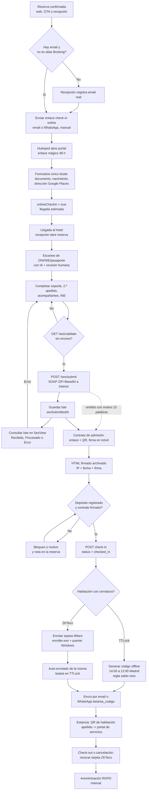

# Cumplimiento legal y check-in (SES, DNI, contrato, acceso, RGPD)

> Ampliación de las secciones 12-14 de `docs/01-FUNCIONALIDADES.md`. Análisis hecho leyendo el código del repo origen (Hotel Betania) en modo solo lectura. Las rutas citadas son de ese repo (`src/...`, `frontend/...`).

## 0. Resumen ejecutivo

| Bloque | Estado | Nota clave |
|---|---|---|
| Parte de viajeros SES Hospedajes (RD 933/2021) | Funciona, **manual** | Alta + consulta de lote; la anulación existe en `lib/ses.ts` pero no tiene ruta ni botón |
| Escaneo de documento con IA | Funciona | Visión de Anthropic; valida letra DNI/NIE solo en frontend; no hay lectura MRZ |
| Contrato de admisión + firma | Funciona | HTML firmado archivado en BD; datos fiscales del hotel **hardcodeados** |
| Check-in online del huésped | Parcial | Formulario único solo para el titular; no recoge nº soporte, 2.º apellido ni acompañantes |
| Acceso autónomo (TTLock/ZKTeco) | Funciona | Código TTLock offline y tarjeta ZKTeco→TTLock; regla de saldo cero |
| RGPD | Parcial | Anonimización manual; sin política de retención, sin registro de consentimiento de tratamiento |

---

## 1. SES Hospedajes (Ministerio del Interior)

Ficheros: `src/lib/ses.ts` (cliente), `src/routes/ses.ts` (API), `frontend/views/SesView.tsx` (listado/consulta), botón y modal en `ReservationDetailView.tsx`, `scripts/ses-test.ts` y `scripts/ses-catalogo.ts`.

### 1.1 Configuración y entornos

Variables de entorno (no se guardan en BD, **una sola cuenta SES por instalación**):

- `SES_USERNAME`, `SES_PASSWORD`: credenciales Basic Auth del servicio web.
- `SES_CODIGO_ARRENDADOR`: va en la cabecera SOAP (máx. 10 caracteres).
- `SES_CODIGO_ESTABLECIMIENTO`: va en el XML interno (máx. 10).
- `SES_APLICACION`: nombre de la aplicación (por defecto "Betania PMS", máx. 50).
- `SES_PRODUCCION=true`: selecciona producción; por defecto **entorno de pruebas**.

Endpoints:

- Pruebas: `https://hospedajes.pre-ses.mir.es/hospedajes-web/ws/v1/comunicacion`
- Producción: `https://hospedajes.ses.mir.es/hospedajes-web/ws/v1/comunicacion`

`isConfigured()` exige las cuatro primeras variables; si faltan, `/submit` y `/consultar` devuelven 503.

### 1.2 Protocolo

1. Se construye el XML interno según `altaParteHospedaje.xsd` v3.1.3 (`xmlns:ns="http://www.neg.hospedajes.mir.es/altaParteHospedaje"`, `elementFormDefault="unqualified"`, orden de elementos exacto del XSD).
2. Se comprime en ZIP (`fflate`, fichero `solicitud.xml`) y se codifica en Base64.
3. Se envuelve en un SOAP `comunicacionRequest` con cabecera `codigoArrendador`, `aplicacion`, `tipoOperacion` (A=alta, B=anulación, C=consulta) y `tipoComunicacion` (`PV` = parte de viajeros).
4. `POST` con `Authorization: Basic`, `SOAPAction: ""`.
5. Se parsea la respuesta con regex tolerantes a prefijos de namespace: `codigoRetorno` o `codigo`, `descripcion`, `lote`, y `faultstring` para SOAP Fault. Si no se reconoce nada (`codigo = -1`) se loguea HTTP y los primeros 2000 caracteres del cuerpo y se lanza un error con la causa.

**Riesgo de seguridad**: la llamada usa `tls: { rejectUnauthorized: false }` (la CA FNMT del Estado no viene en los bundles de Bun). Con credenciales y datos de identidad viajando por ahí, hay que sustituirlo por la CA FNMT añadida al trust store, no desactivar la verificación.

### 1.3 Qué contiene el parte

Un parte = un **contrato de hospedaje** + una persona por huésped (`rol = VI`, viajero):

| Bloque | Campo SES | Origen / regla |
|---|---|---|
| Establecimiento | `codigoEstablecimiento` | Variable de entorno |
| Contrato | `referencia` | `RES-{externalCode ?? id}`, truncado a 50 |
| | `fechaContrato` | = fecha de entrada |
| | `fechaEntrada` / `fechaSalida` | Fecha de la reserva + **14:00:00 / 12:00:00 fijos** (no usa la hora real de llegada) |
| | `numPersonas` | Nº de huéspedes realmente cargados (titular + adicionales), no `reservations.people` |
| | `numHabitaciones` | Siempre `1` (aunque la reserva tenga `extraRoomIds`) |
| | `pago.tipoPago` | Por defecto `EFECT`; **no se informa el medio de pago real** de la reserva |
| Persona | `nombre`, `apellido1`, `apellido2` | `apellido2` solo si existe |
| | `tipoDocumento`, `numeroDocumento`, `soporteDocumento` | **Solo adultos** (los menores se envían sin documento) |
| | `fechaNacimiento`, `nacionalidad` (ISO-3), `sexo` | `H` / `M` / `X`; `unspecified` no se envía |
| | `direccion` (calle, `codigoMunicipio` INE o `nombreMunicipio`, `codigoPostal`, `pais`) | Ver 1.5 |
| | `telefono`, `correo` | Al menos uno de los dos |

Mapeo de tipo de documento (catálogo oficial `TIPO_DOCUMENTO`): `dni`→`NIF`, `nie`→`NIE`, `passport`→`PAS`, `driving_licence`→`OTRO`, `other`→`OTRO`. No se usan `CIF`/`CIF_E`.

### 1.4 Validación local (`validateGuest`) por campo y tipo de documento

Se ejecuta antes de enviar (`GET /api/ses/validate/:id` y dentro de `POST /api/ses/submit/:id`) sobre titular y adicionales, y devuelve la lista `{field, message}` con prefijo "Titular:" o "Huésped N (nombre):".

| Regla | Aplica a |
|---|---|
| Nombre, primer apellido y fecha de nacimiento obligatorios | Todos |
| Al menos email **o** teléfono | Todos |
| Email con patrón del XSD `[^@]+@[^.]+\..+` | Si hay email |
| Tipo y número de documento obligatorios | Solo **adultos** (edad calculada a la fecha de entrada; menor = <18) |
| Nº de soporte obligatorio | Adultos con `dni` o `nie` |
| Segundo apellido obligatorio | Adultos con `dni` (en el XSD el `apellido2` es obligatorio para NIF) |

Lo que **no** valida el servidor: letra de control DNI/NIE (solo la comprueba el frontend, ver sección 2), formato del pasaporte, código postal (formato 5 dígitos), nacionalidad obligatoria, dirección completa (solo la exige la UI del check-in: calle, CP, municipio e INE si es España, `guestAddressComplete`), ni `parentesco` de menores.

Antes del check-in manual, la UI llama a `/ses/validate/:id` y bloquea si hay errores, y exige además dirección completa de todos los huéspedes.

### 1.5 País, ISO-3 y dirección

- El SES exige **ISO 3166-1 alfa-3**. `toIso3()` convierte desde `frontend/data/countries.json` (249 países, mismo fichero del selector de país). Si ya llega en 3 letras la deja tal cual; si no la encuentra devuelve el código sin convertir (SES lo rechazaría).
- La nacionalidad usa `nationality` del huésped; el país de la dirección usa `iso3(nationality) || iso3(addressCountryCode) || 'ESP'`. Es decir, **el país de residencia se toma de la nacionalidad**, no de `addressCountryCode` (un español residente en Francia, o un francés residente en España, se comunicaría con el país equivocado). Vale la pena corregirlo para vender a terceros.
- Dirección: si el país es ESP y hay `cityIneCode` de 5 dígitos se envía `codigoMunicipio` (INE); si no, `nombreMunicipio`. Valores de relleno: calle `-`, código postal `00000` si faltan.
- `guests.cityIneCode` se rellena desde el catálogo de municipios (`frontend/data` / `MUNICIPALITIES`) por nombre normalizado, en el check-in online y en la ficha del huésped.

### 1.6 Huéspedes adicionales

`collectAndValidate()` (`routes/ses.ts`) toma el titular (`reservations.guestId`) y los `guestId` distintos de `reservation_nights` (deduplicados). Cada acompañante es un `guests` propio, creado desde la ficha de reserva o por el escáner de DNI (sección 2). El nº de personas del parte es el nº de huéspedes cargados: si la reserva dice 3 personas pero solo hay 2 fichas, el parte sale con 2 (no hay aviso de "faltan viajeros").

### 1.7 Envío, estado, consulta y anulación

| Acción | Ruta | Comportamiento |
|---|---|---|
| Validar | `GET /api/ses/validate/:id` | Sin enviar nada; devuelve `valid`, `errors`, `guests` |
| Enviar | `POST /api/ses/submit/:id` | Exige SES configurado, huésped y habitación asignados; 422 con `missingFields` si falta algo; guarda `sesSubmittedAt` y `sesLocutorioId` (= nº de lote); marca `checkinSesSent = true` si el check-in lo había dejado pendiente |
| Estado de una reserva | `GET /api/ses/status/:id` | Si hay lote y SES configurado consulta el estado en vivo; si falla, devuelve lo guardado |
| Listado | `GET /api/ses/partes?from&to` | Reservas con `sesSubmittedAt` en el rango |
| Consulta de lote | `GET /api/ses/consultar/:lote` | `tipoOperacion C`; devuelve estado global y, por comunicación, `codigoComunicacion`, estado y lista de `error` |
| Anulación | (solo `anularComunicaciones()` en `lib/ses.ts`) | `tipoOperacion B` con `codigoComunicacion`; **no está expuesta en ninguna ruta ni pantalla** |

`SesView` muestra los partes con rango por defecto hoy+ayer, botón "Consultar" por lote y "Consultar todos" (limitado a 2 días de rango para no saturar el SOAP del Ministerio). Códigos de estado tratados: 1 Recibido, 2 Procesado, 3 Error, 4 Anulado (6 se cuenta como error en el resumen).

Limitaciones detectadas:

- Se guarda el **lote**, no el `codigoComunicacion` individual, que es lo que pide la anulación. Hoy habría que consultar el lote para obtenerlo.
- Una sola columna `sesLocutorioId` por reserva: reenviar sobrescribe el lote anterior y deja una comunicación duplicada en SES (la UI permite "reenviar" con un botón). No hay historial de envíos.
- No hay comunicación de **modificación** ni de **baja por cancelación/no-show** (si se envió y luego la reserva cambia de fechas o se cancela, no se corrige en SES).
- Sin reintento automático ni cola: si SES está caído el parte queda sin enviar.
- `fechaEntrada`/`fechaSalida` fijas a 14:00/12:00 aunque el huésped llegue a otra hora.

### 1.8 Flujo en recepción y alertas

El check-in de recepción (`doCheckIn`, `ReservationDetailView`) sigue este orden: email real (no alias `@guest.booking.com`) → depósito obligatorio → `GET /ses/validate` (bloquea si falla) → dirección completa → tarjeta ZKTeco → **si no se ha enviado SES, pide motivo (mínimo 15 palabras)** → si hay contrato sin firmar, pide motivo → `POST /check-in`. Los motivos se guardan como nota de la reserva ("Check-in sin enviar SES Hospedajes. Motivo: ..."). Existe también el atajo `doCheckinAndSes` en el modal de edición de huésped (check-in + envío SES seguidos).

Esto es un control **de proceso, no técnico**: el backend `POST /:id/check-in` no exige SES ni valida datos; un cliente de API podría saltárselo. El estado queda en `reservations.checkinSesSent`.

Alertas relacionadas: `checkin-abandoned` (check-in abandonado), `booking-no-checkin`, `in-house-no-access`, `zkteco-unenrolled-card`. **No existe alerta de "parte SES pendiente"** ni de "parte con errores en SES" ni de plazo vencido (ver huecos).

### 1.9 Qué falta (SES)

- Alta de arrendador y establecimiento en SES: es un trámite administrativo previo (certificado, solicitud en la sede del Ministerio) que el producto **no asiste**; el código de arrendador/establecimiento se pega a mano en variables de entorno.
- Multi-establecimiento y multi-arrendador (una cuenta por propiedad): hoy es una única cuenta por instalación vía `.env`.
- Envío automático dentro del plazo legal (24 h desde el inicio del hospedaje) con alerta si vence.
- Comunicación de modificación y anulación; histórico de lotes y de `codigoComunicacion`.
- `parentesco` para menores acompañando a adultos; `tipoPago` real; fecha/hora real de entrada; nº de habitaciones real.
- Mossos d'Esquadra / Ertzaintza: el código **no tiene ninguna integración específica**. La normativa estatal canaliza el parte a través de SES Hospedajes, pero para un cliente en Cataluña o País Vasco hay que confirmar con su asesor si el canal estatal basta o si hay obligación de comunicación adicional a la policía autonómica. No asumir cubierto.

---

## 2. Escaneo de DNI / NIE / pasaporte con IA

Ficheros: `src/routes/id-scan.ts`, `frontend/views/IdScanView.tsx`, `frontend/lib/idDocValidation.ts`.

### 2.1 Flujo

1. `IdScanView` (web móvil) lista las reservas elegibles y, por reserva, los "huecos": titular + adicionales ya cargados + `emptySlots = people - 1 - adicionales` (`GET /api/id-scan/:id/slots`).
2. Recepción elige un hueco y fotografía el documento con la cámara. El navegador reduce la imagen (lado máx. 1600 px, JPEG 0,85) antes de subirla.
3. `POST /api/id-scan/extract` recibe un data-URL (`jpeg|jpg|png|webp`, ≤ 8 MB) y llama a la API de Anthropic con **tool use forzado** (`extract_id_document`). **No escribe nada en BD**.
4. La pantalla de revisión muestra los campos extraídos, editables, con la nota `lowConfidenceNote` de la IA si algún dato es dudoso.
5. `POST /api/id-scan/:id/apply` guarda sobre el huésped (`guestId` existente de **esa** reserva) o crea un acompañante nuevo y lo enlaza con una fila por noche en `reservation_nights`; recalcula `reservations.people`.

Se puede mandar la foto del reverso del DNI: el prompt indica centrarse solo en el nº de soporte si el resto ya se leyó.

### 2.2 Campos extraídos

`idDocType` (dni/nie/passport/driving_licence/other), `firstName`, `lastName`, `secondLastName`, `gender`, `dateOfBirth`, `nationality` (texto tal cual aparece), `idDocNumber`, `idDocSupportNumber`, `idDocIssueDate`, `idDocExpiryDate`, `lowConfidenceNote`. Obligatorios en la herramienta: tipo, nombre y primer apellido.

Detalles:

- El comentario del código dice "claude-haiku" pero la constante `VISION_MODEL` es `claude-sonnet-5`; la sección 13 de `01-FUNCIONALIDADES.md` también menciona Haiku. Está **desactualizado**: hoy se usa Sonnet (más coste por escaneo).
- Requiere `ANTHROPIC_API_KEY`; si falta, error del servidor.
- `nationality` se guarda como texto libre: no se convierte a ISO. El parte SES convierte con `toIso3()`, que solo acierta si el valor es un código ISO válido; un "ESPAÑOLA" leído del DNI **no** se convierte y SES lo rechazaría. Es el punto frágil entre escáner y SES.

### 2.3 Validación

`validateIdDocNumber()` (frontend, compartido entre `IdScanView` y los modales de huésped):

- DNI: `^\d{8}[letra]$` y letra de control `TRWAGMYFPDXBNJZSQVHLCKE[n mod 23]`.
- NIE: `[XYZ]\d{7}[letra]`, sustituyendo X→0, Y→1, Z→2 antes del módulo 23.
- Pasaportes y otros: sin validación (ni longitud ni MRZ).
- Muestra la letra correcta esperada en el mensaje de error.

El check-in online del portal (`customer.ts`) solo valida el **formato** (`^\d{8}[A-Z]$`), no la letra de control; y el servidor (`validateGuest`) tampoco. Conviene llevar la función a `src/lib` y usarla en ambos lados.

**MRZ**: no se implementa. La IA lee el texto visual del documento; no se parsea ni se verifica la zona de lectura mecánica (dígitos de control ICAO 9303), que sería la forma barata y determinista de validar pasaportes y NIE/TIE.

### 2.4 Restricciones y privacidad

- Solo reservas con check-in **hoy** (hora Madrid) y estado `arriving` o `confirmed`; `tentative` o ya `checked_in` no valen (hay que usar la ficha normal). Permiso `canManageReservations`.
- Aplica `checkBlockedGuestNames` (sección 5.3).
- **La imagen no se guarda** en el servidor (solo viaja a Anthropic y se descarta); `guests.documentUrl` y `photoUrl` existen en el esquema pero ningún flujo los rellena. Es positivo para RGPD, pero implica que no hay copia del documento si Interior la pide (la ley exige conservar los datos del parte, no la imagen).
- Los datos de identidad se envían a un tercero (Anthropic, EE. UU.). Necesita figurar como **subencargado** en el contrato de encargo y como transferencia internacional en la política de privacidad del hotel.

---

## 3. Autocompletado de dirección y códigos postales

### 3.1 Google Places (portal público)

`GET /api/public/places/autocomplete?q=` y `GET /api/public/places/details/:placeId` (en `routes/public.ts`) usan **Places API (New)** con `GOOGLE_PLACES_API_KEY`:

- Autocomplete: mínimo 3 caracteres, idioma `es`, devuelve hasta 6 sugerencias `{placeId, text}`.
- Details: pide solo `addressComponents,formattedAddress` (FieldMask) y devuelve `address1` (calle + número), `zipCode`, `city` (`locality` → `postal_town` → `administrative_area_level_3` → `_2`), `countryCode` y `formatted`.
- Validación de `placeId` por regex y **límite de 40 peticiones/min por IP** en memoria (se pierde al reiniciar y la IP sale de `x-forwarded-for`, que es falsificable si no hay proxy de confianza).
- El componente `AddressAutocomplete` del portal rellena calle, CP, municipio y país en el formulario de check-in.

Coste y términos: cada sesión consume cuota de la clave de Google del hotel; para producto multi-hotel cada cliente necesita su propia clave o un modelo de reventa de cuota.

### 3.2 Catálogo postal español offline

`src/routes/postal.ts` + `src/lib/postal-es.json` (~8,4 MB, cargado en memoria):

- `GET /api/postal/cp/:cp` → `{city, province}` desde `cpToCity`.
- `GET /api/postal/cities?q=` → ciudades (por nombre o provincia, máx. 30) y barrios (máx. 20); con solo dígitos busca por prefijo de CP (máx. 50).

Se usa en los formularios de la recepción (ficha de huésped). El municipio se mapea al **código INE** con `MUNICIPALITIES` por nombre normalizado, necesario para el XML de SES. Riesgo: municipios con nombres duplicados o bilingües (p. ej. "Alicante/Alacant") pueden no casar y dejar `cityIneCode` vacío; la UI lo detecta (`guestAddressComplete`) y bloquea el check-in manual, pero el check-in online no lo avisa al huésped.

---

## 4. Contrato de admisión y firma digital

Ficheros: `src/lib/contract.ts`, `src/routes/reservations.ts` (`/:id/contract`, `/:id/contracts`), `src/routes/public.ts` (`/contract/:token`), `frontend-public/contract.tsx`, schema `guest_contracts`, PDF base `public/docs/contrato-admision.pdf`.

### 4.1 Flujo

1. Recepción pulsa "Contrato" → `POST /api/reservations/:id/contract`: cancela los enlaces `pending` anteriores de la reserva, crea una fila con **token de 64 caracteres** (dos UUID sin guiones) y caducidad de **24 h**, y devuelve la URL `/sign?t=<token>` y un **QR** (PNG data-URL) para que el huésped lo escanee con su móvil.
2. `GET /api/public/contract/:token` (sin autenticación): devuelve `status`. Si está `signed` solo informa; si `cancelled` o inexistente, 404; si caducó, 410; si está pendiente, devuelve el HTML de previsualización (`renderContract(data)`) generado **en el momento** con los datos vivos de la reserva.
3. El huésped dibuja la firma en un lienzo. `POST /api/public/contract/:token/sign` recibe un PNG en data-URL (≤ 800 KB), regenera el HTML con la firma embebida en base64 y lo guarda en `guest_contracts.contract_html`, junto con `signed_at` y `signed_ip`.
4. Si el check-in estaba pendiente de contrato, se marca `reservations.checkinHadContract = true`.
5. Recepción consulta el archivo con `GET /:id/contracts` y `GET /:id/contracts/:cid/html`.

### 4.2 Contenido del contrato

HTML autocontenido, bilingüe (inglés/español): datos del hotel, cliente, tipo y nº de documento, fechas, habitación y tipo, personas, tarifa, importe total, declaración de aceptación de condiciones y del reglamento de régimen interior, enlace al PDF del contrato de admisión expuesto en recepción, y bloque de firma con sello: fecha/hora (Madrid), **IP** y nº de reserva.

### 4.3 Evidencias que quedan

- Imagen de la firma + fecha/hora + IP + token + HTML íntegro con los datos tal como estaban al firmar.
- **No** hay hash del documento, sello de tiempo cualificado ni certificado: es firma electrónica **simple** (eIDAS), válida como prueba de aceptación pero débil frente a un repudio. No se genera un PDF firmado por reserva (el "PDF" es el reglamento estático que enlaza el HTML).
- La IP se toma de `x-forwarded-for` (primer valor), por lo que depende de que solo el proxy de confianza la rellene.

### 4.4 Reglas con el check-in

- Si **existe** algún contrato para la reserva y ninguno está firmado, `POST /:id/check-in` devuelve 409 y la UI pide motivo (mínimo 15 palabras) para continuar.
- Si **nunca se generó** contrato, el check-in no lo exige: el control depende de que recepción lo cree.
- Un contrato ya firmado no se puede volver a firmar (409), y generar un enlace nuevo no invalida uno firmado.

### 4.5 Problemas para vender a terceros

- `contract.ts` tiene **hardcodeados** razón social, CIF, dirección, teléfono, nº de registro turístico, logo (URL de `hotelbetania.es`) y nombre del hotel en el título. Debe pasar a datos de la propiedad.
- Mapa de etiquetas con la clave `driving_license` mientras el enum es `driving_licence` (se muestra el código en mayúsculas en vez de la etiqueta).
- El contrato se genera solo en español/inglés y sin selector de idioma para el huésped.
- El importe se imprime del `total` de la reserva sin impuestos desglosados.

---

## 5. Check-in online del huésped

### 5.1 Acceso

El huésped entra al portal con **enlace mágico** por email (`/portal?token=...`, token de `customer_tokens` válido 48 h desde `portalLink()`; el de login manual es de 15 min) o por el flujo `/auth/send`. El portal identifica al huésped por su **email** (`guests.email`), por lo que un teléfono sin email no sirve para este flujo.

### 5.2 Paso a paso (`POST /api/customer/reservations/:id/checkin`)

No es un asistente multipaso: es **un solo formulario** (`CheckInForm` en `frontend-public/portal.tsx`).

1. El huésped (solo si no tiene `onlineCheckIn` y la reserva está `confirmed`/`tentative`) abre "Hacer check-in online".
2. Elige tipo de documento (DNI, NIE, pasaporte, carné de conducir, otro) e introduce número.
3. Nacionalidad (selector ISO-2) y fecha de nacimiento (obligatoria en la UI).
4. Dirección con `AddressAutocomplete` (Google Places) o a mano: calle, CP, ciudad y país (obligatorios en la UI: calle, CP y ciudad).
5. Hora estimada de llegada (opcional).

Validación del servidor (Zod): DNI `^\d{8}[A-Z]$` (sin comprobar letra), NIE `^[XYZ]\d{7}[A-Z]$`, pasaporte/carné `^[A-Z0-9]{3,20}$`, países de 2 letras, fecha de nacimiento anterior a hoy y edad ≤ 120. Resultado: actualiza el huésped titular (documento, nacionalidad, nacimiento, dirección, país; calcula `cityIneCode` solo si el país es `ES` y el municipio casa por nombre), marca `reservations.onlineCheckIn = true` y guarda `arrivalTime`.

### 5.3 Qué NO hace el check-in online

- **No recoge**: nº de soporte (obligatorio para NIF/NIE), segundo apellido (obligatorio para NIF), sexo, teléfono ni datos de acompañantes. Por tanto, **un check-in online "completado" no deja la reserva lista para SES**: `validateGuest` seguirá fallando hasta que recepción complete esos campos (o use el escáner de DNI al llegar).
- No pide firma del contrato, no sube foto del documento, no consentimientos.
- No envía el parte SES ni genera el código de puerta: el check-in online solo prepara los datos; el check-in físico (`POST /:id/check-in`) lo hace recepción.
- Sobrescribe `nationality`/`dateOfBirth` con `null` si el huésped no los manda.

Nombres bloqueados: `checkBlockedGuestNames()` (`routes/guests.ts`) compara de forma normalizada (sin acentos ni mayúsculas) nombre, apellido y segundo apellido contra `properties.blockedGuestNames` (configurable en Reservas → Configuración, p. ej. "Recepción", "Hotel", "Betania") y devuelve 422. Se aplica en alta/edición de huésped y en `/id-scan/apply`; **no** en el check-in online (el huésped no modifica el nombre) ni en el check-in de recepción (`checkInGuestSchema`). Sirve para impedir partes SES con nombres de relleno.

### 5.4 Flags de seguimiento y abandono

En `reservations`: `checkinStartedAt`, `checkinHadContract`, `checkinZktecoEnrolled`, `checkinSesSent`, `checkinAbandonedAt`, `checkinAbandonedBy`.

- Se sellan en el check-in físico con el estado real de contrato, tarjeta y SES en ese momento (`true`/`false`); cuando recepción completa después el paso pendiente, la ruta correspondiente los pasa a `true` (SES, contrato, tarjeta).
- `checkinStartedAt` mide la duración real del check-in (inicio en el primer intento, también vía `/checkin-start`).
- Si recepción abandona el flujo el mismo día de la llegada, `POST /:id/checkin-abandon` registra autor y hora, y la alerta `checkin-abandoned` avisa; el check-in correcto limpia ambos campos.
- `onlineCheckIn` es el único dato del lado del huésped (booleano).

### 5.5 Recordatorios

Hoy son **solo manuales**: `POST /api/reservations/:id/checkin-email` (plantilla `checkin_link`, editable) y `POST /api/whatsapp/checkin/:id` (plantilla Meta `betania_checkin` con nombre, fechas y enlace). Ambos respetan los ajustes de Ajustes → Mensajes (`channelEnabled('checkin_link', ...)`: canal on/off y canales de venta excluidos) y requieren email (el WhatsApp además teléfono). No hay planificador que envíe el enlace de check-in N días antes ni reenvíe a quien no lo completó; el único scheduler de estados es `autoStatus` (12:00 diario) y el resumen diario.

---

## 6. Acceso autónomo: TTLock, ZKTeco y QR de habitación

### 6.1 Código TTLock (offline)

`src/lib/ttlock.ts` + `src/routes/ttlock.ts`. API cloud europea de TTLock (`euapi.ttlock.com`), credenciales por entorno (`TTLOCK_CLIENT_ID/SECRET/USERNAME/PASSWORD`).

- `createPasscode`: `/keyboardPwd/get`, versión 4, tipo 3 ("periodo"), generado **offline** por el servidor de TTLock, así que no necesita gateway ni Bluetooth. Las fechas se redondean a hora en punto y TTLock exige usar el código al menos una vez en las 24 h siguientes al inicio o queda invalidado.
- `POST /api/ttlock/generate/:id`: exige email y al menos una habitación con TTLock (incluye `extraRoomIds`); **regla de saldo cero** (`realPaidByReservation` vs total; no cuentan los depósitos retenidos; canales exentos configurables en `properties.ttlockBalanceExemptChannelIds`). Ventana: desde 14:00 (o 09:00 con check-in anticipado, que exige comentario y deja nota) hasta las 12:00 del check-out, en **hora de Madrid** (`madridMs`). Un código por habitación, guardado como texto (un código) o JSON (varios) en `reservations.ttlockCode`/`ttlockCodeId`. Borra antes los códigos anteriores. Envía email por habitación según el ajuste `lock_code`.
- `POST /resend/:id` (email) y `POST /whatsapp/:id` (plantilla `betania_codigo`: nombre, habitación, código con `#`, fechas): reenvían el código existente, **con la misma regla de saldo cero**. `ttlockSentAt` registra el envío.
- `POST /revoke/:id`: borra códigos y credenciales de tarjeta y limpia las columnas. **Advertencia del propio código**: un código offline sigue siendo válido en la cerradura hasta su fecha de fin; sin gateway "revocar" es cosmético (solo desaparece del registro).

### 6.2 Tarjeta ZKTeco (controlador C3-400)

`src/lib/zkteco.ts` + `src/routes/zkteco.ts`: el PMS no habla con el controlador, lo hace mediante un **puente Windows** (`ZKTECO_BRIDGE_URL`, `X-API-Key`, `bridge_win`) y un programa de escritorio de enrolado.

1. En recepción, `enroller.exe` pide el nº de reserva (`GET /api/zkteco/enroller/:id` devuelve nombre, habitación y fechas; protegido con cabecera `X-Enroller-Key` = `ZKTECO_ENROLLER_SECRET`) y lee la tarjeta.
2. `POST /api/zkteco/enroller/:id` guarda `zktecoCardNo`, `zktecoCardBe` (UID Mifare de 8 hex), `zktecoEnrolledAt` y limpia `zktecoCardRevokedAt`. `user_id` en el puente = id de la reserva.
3. **Auto-enrolado en TTLock** (si hay Mifare válido, TTLock configurado y `properties.ttlockCardEnrollEnabled`): enrola el mismo UID en todas las cerraduras de las habitaciones de la reserva (`identityCard/add`, vía gateway) y guarda los `cardId` en `ttlockCardIds`.
4. Reutilización: en el check-in, si hay otra reserva del mismo titular (mismo documento), misma habitación y entrada el día de la salida anterior, se reutiliza la tarjeta y se reprograma con la ventana completa (nota automática en la reserva).
5. Revocación: `DELETE /api/zkteco/:id` (UI), y de forma automática al hacer **check-out** o **cancelar** (se marca `zktecoCardRevokedAt`, no se borra el UID para poder reutilizarla). Al ampliar la estancia, `POST /api/ttlock/reenroll-card/:id` re-enrola la misma tarjeta con la nueva fecha de salida.

Alertas: `in-house-no-access` (alojados sin tarjeta), `zkteco-unenrolled-card` (eventos de "tarjeta no existe" en el controlador).

### 6.3 Código en el check-in

Al hacer check-in físico, si la habitación tiene TTLock, `POST /:id/check-in` genera el código y lo envía por email (si el huésped tiene email). **Esta ruta no aplica la regla de saldo cero** de `/ttlock/generate` ni respeta el canal `lock_code` de Ajustes → Mensajes, y calcula `startMs/endMs` con `new Date(fecha+'T14:00:00')`, que depende de la zona horaria del servidor (en AWS/UTC desplaza 1-2 h), a diferencia de `madridMs()`. Lo mismo ocurre en el auto-enrolado de tarjeta del enroller.

Formato del código: el email de `generate` envía el código sin `#`, el de check-in y los reenvíos con `#`.

### 6.4 QR de habitación (no abre la puerta)

`src/routes/room-access.ts`: cada habitación tiene un `qrToken` opaco. El huésped alojado en ese momento (reserva `checked_in`/`checking_out`) escanea el QR, confirma su **primer apellido** (`POST /verify`, con limitación de intentos fallidos) y recibe un JWT corto (`type: room-guest`) acotado a esa reserva, con vida hasta ~6 h tras el check-out (máx. 30 días). Con él puede ver la estancia, ampliar, comprar extras, dejar feedback y pedir limpieza (`housekeeping-request`). Cada carga de página se registra en `roomAccessVisits`. **No abre la cerradura**: es un portal de autoservicio. Existe `qr-habitaciones.pdf` en la raíz del repo con los QR impresos.

---

## 7. RGPD y protección de datos

### 7.1 Datos personales que se guardan (tabla `guests`)

- Identificación: nombre, apellidos, sexo, fecha de nacimiento, nacionalidad.
- Documento: tipo, número, nº de soporte, emisor, fechas de expedición y caducidad.
- Contacto y residencia: email, teléfono, dirección completa, municipio INE, país.
- Perfil interno: VIP, `blacklistReason`/`blacklistSeverity` (lista negra), valoraciones del huésped y del hotel, `purposeOfStay`, `specialInfo1/2`, `childRelationship`.
- Multimedia: `photoUrl`, `documentUrl` (hoy sin uso).
- En otras tablas: firma manuscrita e IP en `guest_contracts`; códigos de acceso en `reservations`; email del portal en `customer_tokens`.

Flujos con terceros: SES (Ministerio), Anthropic (escaneo de DNI y asistente IA), Google (Places), Resend (email), Meta (WhatsApp), TTLock (cloud), Stripe (pago, no gestionado en este documento).

### 7.2 Consentimientos

- Existe **un único consentimiento**: `guests.emailConsentGiven` y `reservations.emailConsentGiven` (casilla "Consentimiento email (RGPD)" en la ficha), por defecto `false`.
- No hay registro de **qué texto** se aceptó, cuándo ni con qué versión; no hay aceptación de política de privacidad en el check-in online ni en el formulario de contrato; no hay consentimiento diferenciado para marketing, ni para tratamiento de datos de menores.
- La base legal del parte SES (obligación legal) y del contrato (ejecución del contrato) no necesita consentimiento, pero sí **información previa** (art. 13 RGPD): el contrato solo dice que se informa de derechos y reglamento, no incluye cláusula de protección de datos.
- Hay un riesgo adicional con el consentimiento de email: los envíos transaccionales (código de puerta, check-in) no lo consultan, y los de recuperación de carrito/cancelación son comerciales; hay que verificar que usen una base legal adecuada.

### 7.3 Anonimización y retención

- `DELETE /api/guests/:id` es una **anonimización manual** (no borra la fila): pone a `null` email, teléfono, nacimiento, nacionalidad, todos los campos de documento, dirección y país, fotos y consentimiento. **Conserva nombre y apellidos, sexo, `addressCountryCode`, `blacklistReason`, notas especiales y valoraciones**, así que el huésped sigue siendo identificable por nombre.
- No limpia `guest_contracts` (HTML con nombre, nº de documento, firma e IP), notas de reserva ni facturas, que pueden contener datos personales.
- **No hay política de retención automática**: ningún job purga o anonimiza por antigüedad. La normativa del parte de viajeros obliga a conservar los datos 3 años (Ley Orgánica 4/2015 y RD 933/2021); a partir de ahí no hay base para mantener documento y dirección. Hoy se quedan para siempre.
- La imagen del documento escaneado no se persiste (ver 2.4).
- Sesiones: JWT de habitación y tokens de portal caducan; `customer_tokens` no se purgan.

### 7.4 Medidas de seguridad observadas

Roles para ver datos (`canManageReservations`), tokens opacos para QR y contrato, rate limit en `room-access/verify` y Places, validación Zod en entradas públicas. A corregir: `rejectUnauthorized: false` en SES, sin cifrado de campos sensibles en BD (documento, firma), `x-forwarded-for` fiable sin proxy verificado, secreto del enroller compartido por cabecera y credenciales del hotel en `.env` (no por tenant).

---

## 8. Diagrama de flujo (reserva a código de puerta)

---

## 9. Huecos y riesgos legales para comercializar a terceros

### 9.1 Críticos (bloquean la venta o exponen al cliente a sanción)

| # | Hueco | Impacto | Acción recomendada |
|---|---|---|---|
| 1 | SES manual, sin plazo, sin alerta de parte pendiente ni de error | El incumplimiento del parte de viajeros tiene sanción administrativa (Ley Orgánica 4/2015) | Cola de envío automática al check-in, alerta de "parte pendiente a X h del plazo", reintentos y panel de errores |
| 2 | Cuenta SES única por `.env`, sin multi-tenant | Imposible servir a varios hoteles | Credenciales y códigos de arrendador/establecimiento por propiedad, cifrados |
| 3 | `rejectUnauthorized: false` en SES | Credenciales y datos de identidad expuestos a MITM | Instalar la CA FNMT en el trust store y retirar la opción |
| 4 | Sin modificación ni anulación de partes (anulación existe sin ruta) | Partes duplicados o incorrectos tras cambios o cancelaciones | Exponer anulación y modificación; guardar `codigoComunicacion` e historial de lotes |
| 5 | Datos del hotel (CIF, razón social, RTA, logo) hardcodeados en contrato | No es utilizable por otro establecimiento | Mover a configuración de la propiedad con plantilla de contrato editable |
| 6 | País del parte tomado de la nacionalidad, nacionalidad en texto libre desde el escáner | Partes con datos incorrectos o rechazados | Normalizar a ISO-3 en el escáner y separar nacionalidad de país de residencia |
| 7 | Retención y supresión sin política ni automatismo | Incumplimiento de minimización y limitación del plazo de conservación | Job de conservación de 3 años y anonimización completa (incluidos contratos, notas y nombre) |

### 9.2 RGPD (encargado de tratamiento)

- Si se vende como SaaS, la empresa vendedora es **encargada del tratamiento** y cada hotel el **responsable**. Hace falta contrato de encargo (art. 28 RGPD), registro de actividades como encargado, y una lista de **subencargados** (hosting, Anthropic, Google, Resend, Meta, TTLock, Stripe) con sus transferencias internacionales y cláusulas contractuales tipo.
- Información al huésped (art. 13) en check-in online y contrato: finalidades (parte policial, contrato, acceso), plazos, destinatarios (Ministerio del Interior), derechos y contacto. Hoy no existe.
- Registro de consentimientos con versión y marca de tiempo si se mantiene el consentimiento de email.
- Datos de menores: SES los exige y el sistema los guarda; falta la regla de quién firma/consiente (representante legal) y el campo `parentesco`.
- Evaluación de impacto y medidas: cifrado en reposo de documento e IP/firma, control de acceso por rol auditado (log de quién ve datos de identidad), copias de seguridad con caducidad (hay `backup-db.sh` con timer, comprobar que las copias respetan la retención) y procedimiento de brechas.
- El asistente IA del PMS y el escáner envían datos personales a Anthropic: documentar el flujo y, si el cliente lo exige, ofrecer desactivación o región.

### 9.3 Mossos d'Esquadra, Ertzaintza y otras comunicaciones

- No hay código específico. La vía estatal (SES Hospedajes) cubre el parte para la Policía Nacional y la Guardia Civil; **para establecimientos en Cataluña y el País Vasco** habría que confirmar con asesoría jurídica si las policías autonómicas reciben el parte a través de SES o requieren registro propio, y documentarlo en el producto para esos clientes.
- Tampoco se contemplan otras obligaciones: estadística turística (INE/Frontur/Familitur), registro de establecimiento autonómico (en Andalucía, el nº RTA aparece solo en el contrato) o tasa turística municipal/autonómica donde aplique.

### 9.4 VERIFACTU y facturación

Fuera del alcance de este módulo, pero relevante para vender: el sistema genera facturas (`/reservations/:id/invoice`) y los contratos citan el importe total. El Real Decreto 1007/2023 (SIF) y el Reglamento VERIFACTU exigen que el software de facturación garantice integridad, trazabilidad, inalterabilidad y, en la modalidad VERIFACTU, envío de registros a la AEAT con huella encadenada y QR; los plazos de adaptación se han ido aplazando (a la fecha de redacción conviene verificar la fecha vigente) y el **fabricante del software** debe emitir declaración responsable. Hay que revisar si las facturas actuales tienen: numeración correlativa inmodificable, registro de facturación con hash encadenado, QR y leyenda, registro de eventos y la declaración responsable. Probablemente **no**; es un hueco comercial grande para cualquier cliente español.

### 9.5 Otros riesgos técnicos con trascendencia legal

- Check-in sin SES/contrato permitido en backend (solo control de UI con motivo libre de 15 palabras): para auditoría, endurecer o dejar registro estructurado (no solo notas).
- Código de puerta enviado desde `/check-in` sin saldo cero y sin respetar el ajuste de canal (inconsistencia con `/ttlock/generate`).
- Zona horaria dependiente del servidor en `POST /check-in` y en el enroller (usar siempre `madridMs`).
- Revocación de códigos TTLock offline no efectiva sin gateway: un código de una reserva cancelada sigue siendo válido hasta su fin.
- Firma electrónica simple sin sello de tiempo ni hash: valorar firma avanzada o al menos hash SHA-256 del HTML y sello temporal.
- Doc desactualizado: `01-FUNCIONALIDADES.md` (sección 13) dice Haiku, el código usa Sonnet.
